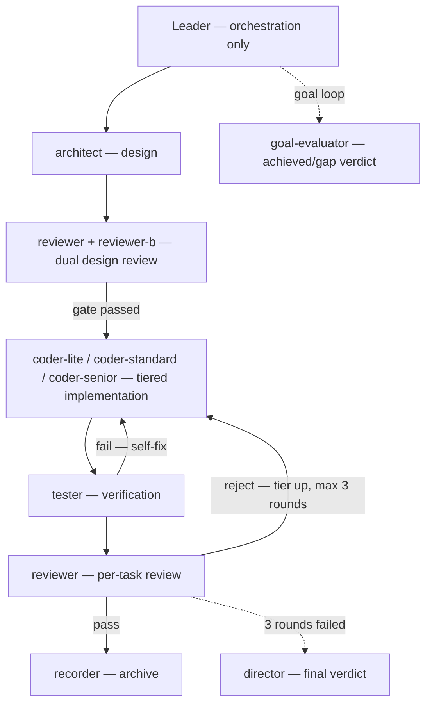
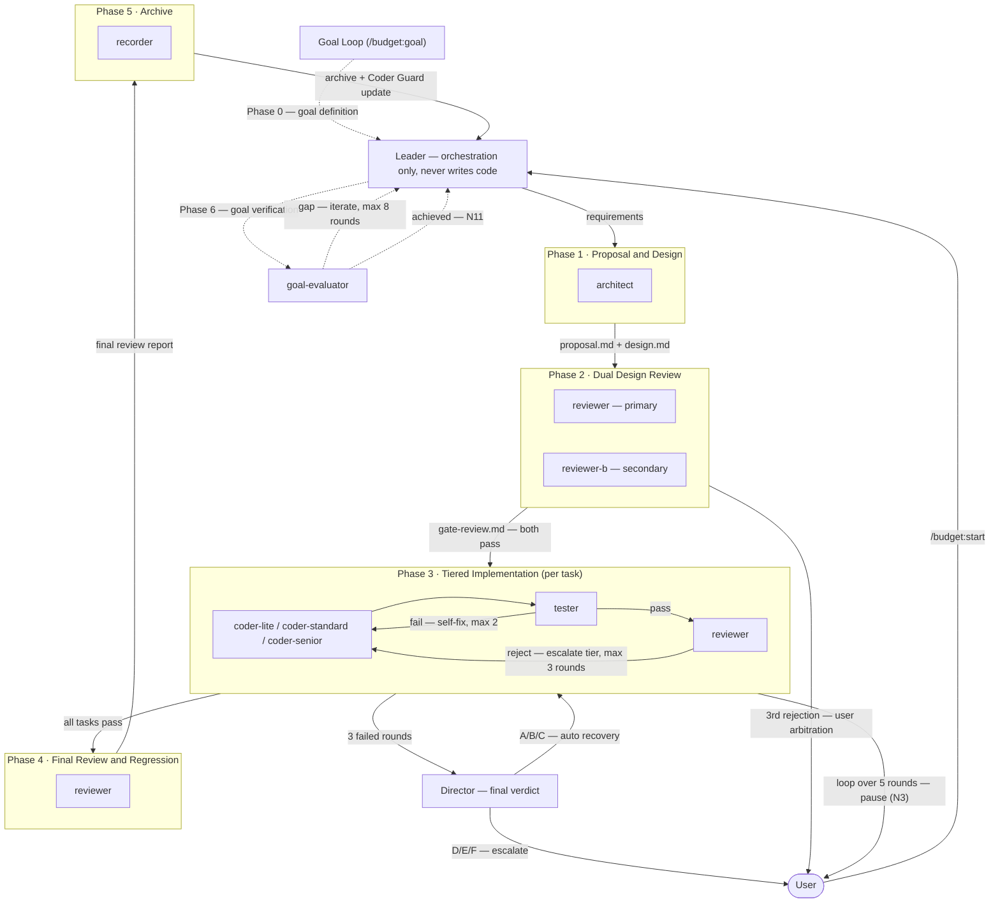
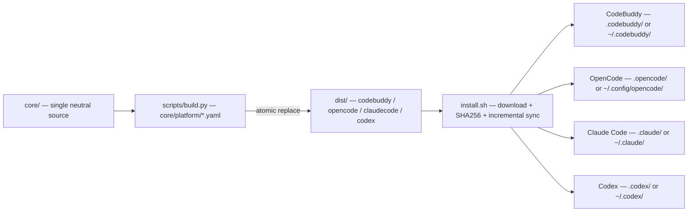

# BudgetBuddy — Your Budget Buddy && An Orchestrated Multi-Agent AI R&D Team with Clear Roles and Hard Gates

**English** | [中文](README_CN.md) | [Changelog](CHANGELOG.md) | [License](LICENSE)

BudgetBuddy turns one generalist AI into a structured development team: **10 specialized sub-agents** with clear responsibilities, an enforced **five-phase gated workflow**, and a Leader that orchestrates but never writes code. Every phase has an exit condition and every loop has a bound — saving tokens is not the pitch, it is a natural consequence of the division of labor and the gates. One neutral source (`core/`) builds into platform-specific distributions for **CodeBuddy**, **OpenCode**, **Claude Code**, and **Codex**; other agent platforms can be added by extending the build DSL (`core/platform/*.yaml`).

## What is BudgetBuddy?

Handing everything to a single "do-everything" AI blends design, implementation, review, verification, and arbitration into one context: responsibilities blur, context bloats, and the loop never converges. The problem is not model intelligence — it is missing team structure. BudgetBuddy splits the work across **10 specialized sub-agents** (three coder tiers routed by task complexity, per-role model assignment), enforces a five-phase workflow (proposal → dual design review → tiered implementation → final review → archive) where each phase has a unique artifact and an exit condition, and bounds every loop with explicit escalation (3 failed review rounds → Director final verdict) — turning AI coding from ad-hoc vibes into a team that delivers.

The kit is self-bootstrapped: this repository is developed with BudgetBuddy's own workflow.

## Features

- **10 specialized sub-agents** — architect, coder-lite / coder-standard / coder-senior, reviewer + reviewer-b (dual review), tester, recorder, director (final verdict), goal-evaluator
- **Five-phase workflow** — proposal & design → dual design review → tiered implementation → final review & regression → archive; phases cannot be skipped
- **Three-tier model presets** — `economic` / `balanced` / `quality`, one command to switch; per-agent `custom` override and `inherit` (follow the main panel model) also supported
- **4 persona themes** — default (professional), tech-legends, sanguo, shuihu; role names and greetings change with the theme
- **Execution agents AutoRun** — 4 execution sub-agents (coder-lite / coder-standard / coder-senior / tester) ship with AutoRun on by default (no per-call approval); `budget setup autorun` manages the rest
- **Universal webhook notifications** — WeCom bot / DingTalk bot (HMAC-SHA256 signed) / Feishu bot (card) / custom webhook, 11 workflow event switches (N1–N11)
- **Coder Guard** — per-coder, per-task-tag failure records over a 5-attempt window; 2+ failures trigger automatic tier downgrade
- **Goal Loop** — goal-driven macro loop: define goal → run pipeline → verify → iterate until the goal is met (max 8 iterations, safety boundaries included)
- **OpenSpec change management** — propose / apply / archive / explore commands with spec-driven change tracking
- **Multi-platform build** — single `core/` source, `scripts/build.py` emits `dist/codebuddy/`, `dist/opencode/`, `dist/claudecode/`, and `dist/codex/`
- **Superpowers integration** — quality-practice skills (TDD, systematic debugging) referenced at the right phases; workflow degrades gracefully when the plugin is absent

## Installation

### Online install (one line)

```bash
curl -fsSL https://raw.githubusercontent.com/fxdgg/BudgetBuddy/main/install.sh | bash
```

> ⚠️ **Trust boundary**: `curl | bash` executes a remote script with your privileges. Review the script first (`curl -fsSL https://raw.githubusercontent.com/fxdgg/BudgetBuddy/main/install.sh | less`) before piping it to bash. The installer downloads the release zip and **enforces SHA256 verification** — it aborts on checksum mismatch and never installs a corrupted package.

Interactive mode asks for platform (CodeBuddy / OpenCode / Claude Code / Codex / all) and scope (project / global). Non-interactive — `BUDGET_PLATFORM` accepts `codebuddy` / `opencode` / `claudecode` / `codex` / `both` / `all` (`all` installs all four platforms, recommended; `both` = CodeBuddy + OpenCode, kept for historical compatibility):

```bash
BUDGET_PLATFORM=opencode BUDGET_GLOBAL=1 bash install.sh   # global OpenCode install
BUDGET_PLATFORM=claudecode BUDGET_GLOBAL=1 bash install.sh # global Claude Code install
BUDGET_PLATFORM=codex BUDGET_GLOBAL=1 bash install.sh      # global Codex install
BUDGET_PLATFORM=all bash install.sh                        # all four platforms (recommended)
```

### Manual install

```bash
git clone <this-repository-url> BudgetBuddy
cd BudgetBuddy
bash install.sh
```

### Platform notes

| Platform | Structural files land in | Management plane |
|----------|--------------------------|------------------|
| CodeBuddy | `.codebuddy/` (project) or `~/.codebuddy/` (global) | `~/.budgetbuddy/` |
| OpenCode | `.opencode/` (project) or `~/.config/opencode/` (global) | `~/.budgetbuddy/` |
| Claude Code | `.claude/` (project) or `~/.claude/` (global) | `~/.budgetbuddy/` |
| Codex | `.codex/` (project) or `~/.codex/` (global) | `~/.budgetbuddy/` |

- **CodeBuddy**: agents/rules/skills/commands land under `.codebuddy/`; hooks are injected into `settings.json` (with backup) and the Superpowers plugin is auto-enabled; the `budget` CLI is written to `~/.local/bin/budget`.
- **OpenCode**: agents/commands/skills land under the OpenCode directory; rules are merged into `AGENTS.md` as a marked block; hooks have no native equivalent — see `core/docs/opencode-setup-notes.md` for the plugin extension point.
- **Claude Code**: agents/commands/skills land under `.claude/` (project) or `~/.claude/` (global); rules are merged into `CLAUDE.md` (project root or `~/.claude/CLAUDE.md`) as a marked block; the management plane is shared with OpenCode under `~/.budgetbuddy/`; hooks three-event notifications are supported (Notification / PermissionRequest / SubagentStop).
- **Codex**: skill-directory form — the workflow kit lands as `skills/budget-workflow/` (SKILL.md + reference docs + agents/rules material) under `.codex/skills/` (project) or `~/.codex/skills/` (global); a lightweight rules index (well under 1 KiB) is merged into `AGENTS.md` as a marked block (full rule text is read on demand from the skill to stay below the AGENTS.md 32 KiB doc limit); `[features] multi_agent = true` is idempotently injected into `config.toml` (with backup) to enable the multi-agent spawn tools; model IDs are deployment aliases — map them to actual models in your deployment environment before use.
- Windows: use Git Bash or WSL (PowerShell aliases `curl` to `Invoke-WebRequest`).
- Project and global installs can coexist; project-level takes priority.

## Quick Start

### CodeBuddy

```
/budget:start "Add user login API with JWT auth"
```

### OpenCode

```
/budget-start "Add user login API with JWT auth"
```

### Claude Code

```
/budget:start "Add user login API with JWT auth"
```

A project-level install lands agents/commands/skills under `.claude/` and merges the rules into `CLAUDE.md` as a marked block; a global install lands under `~/.claude/` (with `~/.claude/CLAUDE.md`). Hooks three-event notifications are supported on Claude Code (Notification / PermissionRequest / SubagentStop); `budget notify "<msg>" <event>` remains available for explicit sends.

### Codex

```
budget-start: Add user login API with JWT auth
```

Codex has no slash-command mechanism — say the trigger phrase (or any natural language like "start the budget workflow") and the `budget-workflow` skill activates. Prerequisites handled by the installer: `[features] multi_agent = true` is injected into `config.toml` to enable the multi-agent spawn tools, and a lightweight rules index is merged into `AGENTS.md`. Two manual prerequisites remain: (1) log in to the Codex CLI (`codex login`) — the spawn tools are only available in a signed-in session; (2) the model IDs are deployment aliases (e.g. `gpt-5.6-terra`) — map them to actual models in your deployment environment; tier lookup at spawn time uses `budget setup show` / `budget setup models`.

The Leader analyzes the request, dispatches architect → dual reviewers → tiered coders → tester → final review → recorder, and reports back. For goal-driven iteration:

```
/budget:goal "Keep improving until all tests pass and coverage >= 80%"   # CodeBuddy / Claude Code
/budget-goal "Keep improving until all tests pass and coverage >= 80%"   # OpenCode
```

On Codex, state the goal in natural language (e.g. `budget-goal: Keep improving until all tests pass and coverage >= 80%`) — no slash commands.

### Common commands

| Command (CodeBuddy) | Command (OpenCode) | Command (Claude Code) | Purpose |
|---------------------|---------------------|-----------------------|---------|
| `/budget:start <requirement>` | `/budget-start <requirement>` | `/budget:start <requirement>` | Start the five-phase workflow |
| `/budget:goal <goal>` | `/budget-goal <goal>` | `/budget:goal <goal>` | Start / resume the Goal Loop |
| `/budget:status` | `/budget-status` | `/budget:status` | Query workflow progress |
| `/opsx:propose` | `/opsx-propose` | `/opsx:propose` | Propose a new OpenSpec change |
| `/opsx:apply` | `/opsx-apply` | `/opsx:apply` | Implement tasks from a change |
| `/opsx:archive` | `/opsx-archive` | `/opsx:archive` | Archive a completed change |
| `/opsx:explore` | `/opsx-explore` | `/opsx:explore` | Explore ideas before proposing |

Natural language triggers ("start development", "implement X", "fix X bug") activate the same workflow.

On Codex, slash commands do not apply — the command bodies ship as reference docs inside the `budget-workflow` skill and are invoked with the same trigger phrases in natural language (e.g. `budget-start: <requirement>`).

### Setup subcommands (`budget setup <subcommand>`)

| Subcommand | Purpose |
|------------|---------|
| `init [shell]` | Initialize data dirs (`.budget/`, `~/.budgetbuddy/`); `init shell` injects the shell alias |
| `show` | Show current agent / model configuration |
| `status` | Status query (guard summary + active change + agent config) |
| `agent preset\|inherit\|custom` | Switch model preset / inherit panel model / override one agent |
| `persona list\|set\|expand\|show` | Manage persona themes |
| `validate` | Verify installation integrity against the manifest |
| `diff [preset]` | Compare current config vs a preset (default `balanced`) |
| `stats` | Workflow statistics |
| `update` | Incremental update (`budget update` is a top-level alias) |
| `reinstall` | uninstall + init combined |
| `uninstall` | Uninstall (offline, local-manifest driven) |
| `guard` | Query / reset Coder Guard records |
| `quickstart` | Interactive guided tour (aliases `tour`, `wizard`) |
| `models` | Show the model catalog |
| `notify "<msg>" <event>` | Send a notification (top-level `budget notify`) |
| `help` | Show help |

> On Codex, `agent preset|inherit|custom` degrade to guidance output — Codex agents have no frontmatter model to rewrite; the model tier is resolved by the Leader at spawn time from `budget-models.json` (default `balanced`). Query the tier table with `budget setup show` / `budget setup models`, and override via `platforms.codex.presets` in the models file or an explicit model on the spawn call.

## Optional: OCR Pre-Review Integration

BudgetBuddy's dual review (`reviewer` / `reviewer-b`) can optionally run a machine pre-review powered by the open-source Alibaba OpenCodeReview CLI (`ocr`). The pre-review acts as a **detector**: it scans the diff and surfaces candidate findings that augment the reviewers' judgment. Final verdicts and A/B/C/D ratings remain the **reviewers'** call — it is **not a gate** and never blocks the workflow.

### Install

```bash
npm i -g @alibaba-group/open-code-review
```

### Model configuration (choose one)

- **Standalone LLM key** — run `ocr config provider && ocr config model` and follow the prompts.
- **Delegate mode** — run `ocr delegate` to reuse the host quota; no extra key required.

### Rule set

`budget setup ocr` installs the rule template distilled from the `budget-*-style` language guides to `~/.opencodereview/rule.json`:

```bash
budget setup ocr
```

- Idempotent: re-running with identical content is a no-op.
- If the target already exists with different content, the file is backed up and confirmation is requested before overwriting; in non-interactive environments the overwrite is skipped by default.
- A project-level `.opencodereview/rule.json` always takes priority over the global layer installed by BudgetBuddy — following the native OCR precedence: `--rule` > project > global > built-in.

### Claude Code (optional speed-up)

Claude Code users can add the pre-review commands to `permissions.allow` in `settings.json` to avoid repeated approvals. This is a user-side, optional configuration — BudgetBuddy does not manage it.

### Graceful degradation

Without the CLI, a model configuration, or the rule file installed, every BudgetBuddy workflow runs exactly as before.

Official documentation: <https://open-codereview.ai>

## The Agent Team

A Leader orchestrates 10 specialized sub-agents. Every role is defined once in `core/agents/` and rebuilt per platform by the build pipeline.

| Agent | Layer | Responsibility | When it runs |
|-------|-------|----------------|--------------|
| `leader` | Orchestration | Analyzes requests, assembles prompts, routes tasks — **never writes code** | Entire workflow |
| `architect` | Design | Proposal & design authoring, gate review, architecture decisions | Phase 1 |
| `reviewer` | Review | Primary review — code quality, security, spec compliance | Phase 2 design review, per-task & final review |
| `reviewer-b` | Review | Secondary review — independent perspective, cross-checks the primary | Phase 2, parallel with `reviewer` |
| `coder-lite` | Implementation | Low complexity — CRUD, config edits, boilerplate, copy changes; cheapest models | Phase 3, routed by task tag |
| `coder-standard` | Implementation | Medium complexity — business features, bug fixes, API endpoints, unit tests | Phase 3, routed by task tag |
| `coder-senior` | Implementation | High complexity — architectural code, cross-module changes, security, concurrency | Phase 3, routed by task tag |
| `tester` | Verification | Runs tests, verifies compilation, checks build output | Phase 3, after every coder |
| `director` | Escalation | Final verdict when 3 review rounds all fail (root-cause classes A–F) | Exception path only |
| `goal-evaluator` | Verification | Independent achieved/gap verdict for goal loops — reads reports, runs nothing | Goal loop only |
| `recorder` | Knowledge | Captures lessons, archives changes, updates docs | Phase 5 archive |

### Role layering



The full five-phase flowchart (gate artifacts, loop caps, escalation paths) lives in [Architecture](#architecture).

### Persona themes

Role names and greetings come from persona themes — 4 themes × 11 roles; only naming changes, never behavior:

| Theme | Style | Leader / architect / coder-senior |
|-------|-------|-----------------------------------|
| `default` | Standard professional naming | Leader / Architect / Coder-Senior |
| `tech-legends` | Modern legendary engineers | Linus Torvalds / Dennis Ritchie / Jeff Dean |
| `sanguo` | Three Kingdoms strategists & generals | Liu Bei / Zhuge Liang / Guan Yu |
| `shuihu` | Liangshan marsh outlaws | Song Jiang / Wu Yong / Lin Chong |

`budget setup persona list|set|show` inspects and switches themes; `budget setup persona expand` renders agent prompts under the active theme.

## Architecture



### Build and platform distribution



### Key rules

- **Leader never writes code** — every code change goes through a tiered coder agent, even a one-line typo
- **tester and reviewer are mandatory** — each task must pass tester verification and reviewer review before it counts as done
- **Review Gate escalation** — failed review escalates the coder tier (lite → standard → senior), max 3 rounds; a task loop is capped at 5 rounds (3 tiered reviews + 2 self-fixes) before pausing for the user
- **Director final verdict** — when 3 rounds all fail, Director classifies the root cause (6 classes); A/B/C trigger auto-recovery, D/E/F escalate to the user
- **Coder Guard** — before dispatch, the Leader checks the coder's failure record for the task tags; 2+ failures in the last 5 attempts force a tier downgrade

Component-level diagrams live in [`core/docs/architecture.md`](core/docs/architecture.md).

## Model Presets

| Preset | Positioning | Typical shape | Claude Code native models | CodeBuddy typical models | OpenCode typical models | Codex typical models (deployment aliases) |
|--------|-------------|---------------|---------------------------|---------------------------|--------------------------|--------------------------------------------|
| `economic` | Maximum savings | Free/budget models carry most roles; premium model only for the final verdict | haiku family (`claude-haiku-5-5`) | `deepseek-v4-flash` | `deepseek/deepseek-flash` | `gpt-5.6-luna` |
| `balanced` | Balanced (recommended) | High-value models on architect/reviewer, mid-tier on coders, budget models on tester/recorder | sonnet family (`claude-sonnet-5-5`) | `deepseek-v4-flash` | `deepseek/deepseek-flash` | `gpt-5.6-terra` |
| `quality` | Maximum quality | Premium models on architect/coder-senior/director, strong models elsewhere | opus family (`claude-opus-5-5`) | `deepseek-v4-pro` | `deepseek/deepseek-v4-pro` | `gpt-5.6-sol` |

> Typical models are the `coder_standard` role's model ID per tier in `core/models/budget-models.json`; the full four-platform preset tables are generated at build time into `dist/<platform>/docs/MODEL_SELECTION.md` (also see `budget setup models`).
>
> The Claude Code native model IDs for the three presets were verified in a real Claude Code environment on 2026-10-20 (Claude Code CLI 2.1.304, zero warnings); use `budget setup agent custom` to override.
>
> External model sources extend the catalog without editing the built-in file: CodeBuddy client config (`~/.codebuddy/models.json`) is picked up automatically, and the `BUDGET_EXTERNAL_MODELS` environment variable accepts one or more `models[]`-format JSON files or directories (`:`-separated, `~` expansion supported). External IDs are listed by `budget setup models` and work directly with `budget setup agent custom <id>`.
>
> The Codex preset IDs are deployment aliases — map them to actual models in your deployment environment before use. They are permanently marked unconfirmed (`platforms.codex.unconfirmed_ids`) since alias mapping cannot be verified centrally; all ten roles share one model per tier on Codex.

```bash
budget setup agent preset economic    # switch preset (rewrites agent frontmatter)
budget setup agent custom coder-lite kimi-k2.7   # override one agent's model
budget setup agent inherit coder-lite            # follow the main panel model
budget setup show                     # inspect the result
```

> On Codex these `agent preset|custom|inherit` subcommands degrade to guidance (no frontmatter model to rewrite — the Leader resolves the tier at spawn time); use `budget setup show` / `budget setup models` to inspect the tier table.

The full catalog (models, tiers, costs, aliases, four-platform preset tables) is generated at build time into `dist/<platform>/docs/MODEL_SELECTION.md`.

## Execution Agents AutoRun (Approval-Free)

On CodeBuddy, the 4 execution sub-agents ship with AutoRun **on by default** — their tool calls no longer pop a per-call approval dialog (「允许一次」 remains an IDE capability):

- **Default-on**: `coder-lite` / `coder-standard` / `coder-senior` / `tester`
- **Per-call confirmation kept**: architect, reviewer + reviewer-b, recorder, director, goal-evaluator — opt them in with `budget setup autorun`

```bash
budget setup autorun list                 # status: global choice list + live install state
budget setup autorun on reviewer          # turn AutoRun on for one agent
budget setup autorun off coder-lite       # turn AutoRun off for one agent
```

- **`list` reads as two columns** — the global choice list (`~/.budgetbuddy/auto-run.json`) plus the live install state per agent; differences (e.g. manual IDE edits made after the state file exists) are shown as-is.
- **Multiple project-level installs** — `on`/`off` patch only the **currently detected install** while the choice is recorded in the single global state file, so **run `on`/`off` once per project**; use the `list` two columns to spot the divergence.
- `apply` is an internal replay/repair command used by the installer — it is not a user-facing command.

> ⚠️ **Safety notice**: AutoRun makes **every** tool call within the agent's permission scope approval-free — approval is the last manual gate. The 4 default-on agents carry `bash_allow: ["*"]`, i.e. they can run **arbitrary shell commands without approval** (`rm -rf`, `git push -f` all match `*`). Turning AutoRun on for the git-class agents (architect / recorder / reviewer / reviewer-b, `bash_allow: ["git *"]`) allows high-risk git commands without approval, e.g. `git push --force`, `git clean -fd`, `git checkout -- .`. Only enable it knowingly.

**Persistence** — AutoRun choices are stored in the user data directory `~/.budgetbuddy/auto-run.json`; uninstall does not clear it, and a reinstall restores it (replayed by the installer). `budget setup update` touches neither the agent files nor the state file — the completion summary's 「user data: kept」 covers `auto-run.json`.

### Platform differences

| Platform | AutoRun mechanism |
|----------|-------------------|
| CodeBuddy | Subagent frontmatter `enabledAutoRun: true`; the 4 execution agents default on; the other 6 are managed via `budget setup autorun` |
| OpenCode | No auto-run field needed — the permission map (`ask`/`allow`/`deny`) already expresses it: `allow` = approval-free; the 4 execution agents' existing permission mappings are already equivalent |
| Claude Code | No per-sub-agent auto-run switch; approval is handled by the session permission mode / `settings.json` permissions — `budget setup autorun` prints the alternative guidance and exits 0 without changing anything |
| Codex | No auto-run mechanism — agent material frontmatter carries only `name`/`description` metadata; permission boundaries are declared by the Leader in the spawn prompt, and in-session approval is handled by Codex's own approval flow — `budget setup autorun` prints this guidance and exits 0 without changing anything |

## Notifications

Configure once in `.budget/notify.json` (project) or `~/.budgetbuddy/notify.json` (global); the project file wins when present (no merging):

```json
{
  "enabled": true,
  "channels": {
    "wecom":    {"type": "wecom_bot",    "webhook": "https://qyapi.example.com/..."},
    "dingtalk": {"type": "dingtalk_bot", "webhook": "https://oapi.example.com/...", "secret": "SEC..."},
    "feishu":   {"type": "feishu_bot",   "webhook": "https://open.example.com/..."},
    "custom":   {"type": "custom",       "webhook": "https://hooks.example.com/...", "format": "raw"}
  },
  "events": {
    "N7":  {"enabled": true, "channels": ["wecom", "dingtalk"]},
    "N10": {"enabled": true, "channels": ["feishu"]}
  }
}
```

- **11 event switches (N1–N11)** — design-review rejections, review-gate exhaustion, loop overrun, Director intervention, phase transitions, goal achievement, etc.
- **Delivery semantics** — markdown payload, 5s timeout per channel, first success stops delivery, all failures are silent (never blocks the workflow)
- **Security** — the config file is `chmod 600` (owner-only); webhook/secret values never pass through environment variables, command-line arguments, or logs; error output is sanitized to hostname only
- **Claude Code** — hooks three-event notifications are supported (Notification / PermissionRequest / SubagentStop); `budget notify "<msg>" <event>` remains available for explicit sends
- **Codex** — no hooks notifications: Codex hooks are experimental and the kit does not distribute them; `budget notify "<msg>" <event>` remains available for explicit sends

## Repository Layout

```
BudgetBuddy/
├── core/                  # single neutral source — edit here
│   ├── agents/            # 10 agent definitions
│   ├── commands/          # budget (start/status/goal) + opsx (4) command templates
│   ├── docs/              # architecture.md, opencode-setup-notes.md, personas, model template
│   ├── hooks/             # CodeBuddy notify hook
│   ├── lib/               # management-plane modules (setup, state, guard, notify, ...)
│   ├── models/            # budget-models.json + schema
│   ├── personas/          # 5 persona themes
│   ├── platform/          # codebuddy.yaml / claudecode.yaml / opencode.yaml / codex.yaml mapping DSL
│   ├── rules/             # 12 rules (3 P0 + 8 code standards + rtk)
│   ├── skills/            # budget-workflow, budget-notify, 4 openspec skills
│   └── setup.sh           # budget setup entry
├── dist/                  # build output (do NOT hand-edit)
│   ├── codebuddy/
│   ├── claudecode/
│   ├── opencode/
│   └── codex/
├── scripts/               # build.py, scan-brand.py, build-release.sh
├── tests/                 # unit tests (python3 -m unittest)
├── install.sh             # four-platform installer
└── VERSION
```

## Development Guide

- **Edit `core/`, never `dist/`** — `dist/` is generated; hand edits are overwritten and fail the check
- **Build & gate**: `python3 scripts/build.py --check` (also `--strict` for warning-as-error runs)
- **Multi-platform build**: `python3 scripts/build.py [--platform <platform>]` — the valid platform list is enumerated at build time from `core/platform/*.yaml` (currently `codebuddy` / `claudecode` / `opencode` / `codex`); without `--platform`, all platforms are built
- **Brand gate**: `python3 scripts/scan-brand.py` — scans `core/`, `dist/`, `scripts/`, `install.sh`, `README.md`, `README_CN.md`, `CHANGELOG.md` for forbidden terms (the reference project's brand words); the gate must exit 0
- **Tests**: `python3 -m unittest discover -s tests`
- **Release**: `bash scripts/build-release.sh` — runs the check, reads `VERSION`, packages `budgetbuddy-<version>.zip` + `.sha256`
- **Change management**: use the OpenSpec workflow (`/opsx:propose` → review → `/opsx:apply` → `/opsx:archive`); the Leader orchestrates and never writes code itself — all edits go through tiered coder agents

## License

[MIT](LICENSE) — Copyright (c) 2026 BudgetBuddy Contributors
