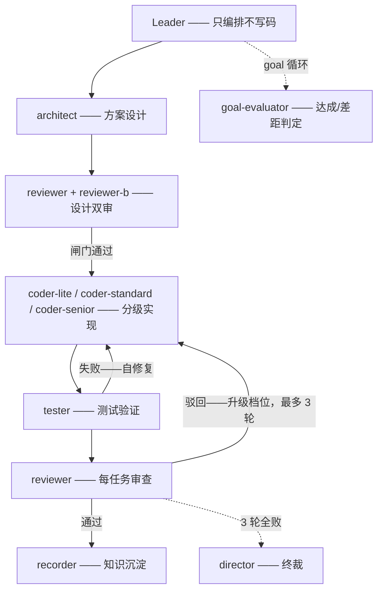
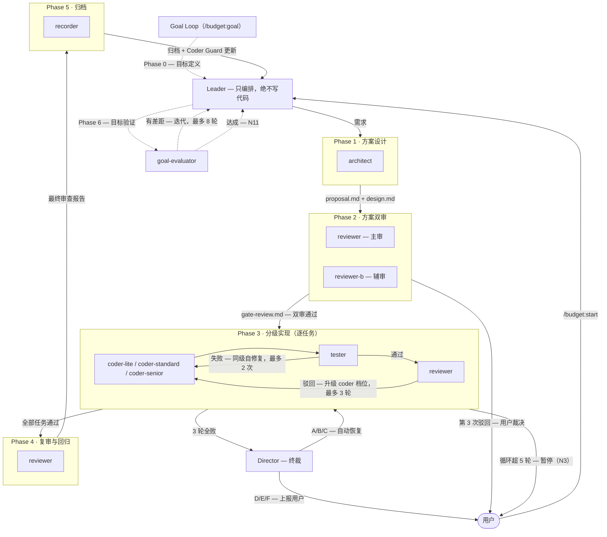
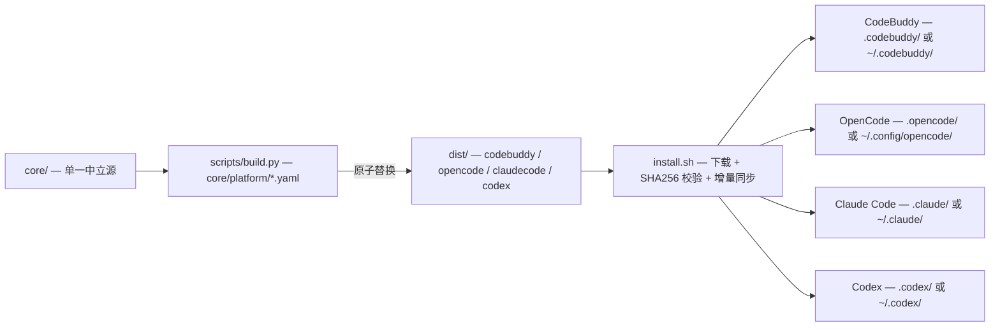

# BudgetBuddy — 分工明确、门禁严格的多 Agent AI 研发团队

**中文** | [English](README.md) | [变更日志](CHANGELOG.md) | [许可协议](LICENSE)

BudgetBuddy 把一个「全能 AI」变成一支有结构的研发团队：**10 个职责明确的专业 sub-agent**、强制执行的**五阶段门禁工作流**、一个只编排不写码的 Leader。每个阶段都有退出条件、每个循环都有上限——省钱不是它的卖点，而是分工与门禁带来的自然结果。单一中立源（`core/`）构建出 **CodeBuddy**、**OpenCode**、**Claude Code** 与 **Codex** 四平台产物；其他 agent 平台可通过扩展构建 DSL（`core/platform/*.yaml`）接入。

## BudgetBuddy 是什么？

把所有事都丢给一个「全能 AI」，方案、实现、审查、验证、裁决就全挤在同一个上下文里——职责混乱、上下文膨胀、循环不收敛。问题不在模型智商，而在缺「团队结构」。BudgetBuddy 把工作拆分给 **10 个专业 sub-agent**（三级 coder 按任务复杂度路由，按角色分配模型），套上强制的五阶段工作流（方案 → 方案双审 → 分级实现 → 复审 → 归档）——每个阶段都有唯一产物和退出条件，每个循环都有上限与兜底（3 轮审查全败 → Director 终裁），把 AI 研发从「随手 vibe」变成一支能交付的生产团队。

本套件自举开发：本仓库自身就是用 BudgetBuddy 的工作流开发的。

## 功能特性

- **10 个专业 sub-agent** — architect、coder-lite / coder-standard / coder-senior、reviewer + reviewer-b（双审）、tester、recorder、director（终裁）、goal-evaluator
- **五阶段工作流** — 方案设计 → 方案双审 → 分级实现 → 复审与回归 → 归档；阶段不可跳过
- **模型三档预设** — `economic` / `balanced` / `quality`，一条命令切换；支持按 agent 的 `custom` 覆写与 `inherit`（继承主面板模型）
- **4 套 persona 主题** — default（专业）、tech-legends、sanguo、shuihu；角色名与称呼随主题切换
- **执行类 agent 免审批（AutoRun）** — 4 个执行类 sub-agent（coder-lite / coder-standard / coder-senior / tester）默认开启 AutoRun（工具调用免逐条审批）；其余 agent 可用 `budget setup autorun` 管理
- **通用 webhook 通知** — 企微机器人 / 钉钉机器人（HMAC-SHA256 加签）/ 飞书机器人（卡片）/ 自定义 webhook，11 个工作流事件开关（N1–N11）
- **Coder Guard 护栏** — 按 coder × 任务标签记录最近 5 次成败；失败 ≥2 次自动触发分级降级
- **Goal Loop** — 目标驱动宏循环：定义目标 → 跑 pipeline → 验证 → 未达标则迭代（最多 8 轮，含安全边界）
- **openspec 变更管理** — propose / apply / archive / explore 命令 + 规格驱动的变更跟踪
- **多平台构建** — 单一 `core/` 源，`scripts/build.py` 产出 `dist/codebuddy/`、`dist/opencode/`、`dist/claudecode/` 与 `dist/codex/`
- **Superpowers 集成** — 在正确阶段引用质量实践 skill（TDD、系统化调试）；插件缺失时优雅降级

## 安装

### 在线安装（一行命令）

```bash
curl -fsSL https://raw.githubusercontent.com/fxdgg/BudgetBuddy/main/install.sh | bash
```

> ⚠️ **信任边界**：`curl | bash` 会以你的权限执行远端脚本。建议先审查脚本（`curl -fsSL https://raw.githubusercontent.com/fxdgg/BudgetBuddy/main/install.sh | less`）再执行。安装器下载 release zip 后**强制 SHA256 校验**——校验失败即中止，绝不安装损坏的包。

交互模式会询问平台（CodeBuddy / OpenCode / Claude Code / Codex / 全部）与作用域（项目 / 全局）。非交互——`BUDGET_PLATFORM` 取值 `codebuddy` / `opencode` / `claudecode` / `codex` / `both` / `all`（`all` = 四平台全部安装【推荐】；`both` = CodeBuddy + OpenCode，历史兼容值）：

```bash
BUDGET_PLATFORM=opencode BUDGET_GLOBAL=1 bash install.sh   # OpenCode 全局安装
BUDGET_PLATFORM=claudecode BUDGET_GLOBAL=1 bash install.sh # Claude Code 全局安装
BUDGET_PLATFORM=codex BUDGET_GLOBAL=1 bash install.sh      # Codex 全局安装
BUDGET_PLATFORM=all bash install.sh                        # 四平台全部安装（推荐）
```

### 手动安装

```bash
git clone <本仓库地址> BudgetBuddy
cd BudgetBuddy
bash install.sh
```

### 平台说明

| 平台 | 结构文件落点 | 管理面 |
|------|-------------|--------|
| CodeBuddy | `.codebuddy/`（项目级）或 `~/.codebuddy/`（全局） | `~/.budgetbuddy/` |
| OpenCode | `.opencode/`（项目级）或 `~/.config/opencode/`（全局） | `~/.budgetbuddy/` |
| Claude Code | `.claude/`（项目级）或 `~/.claude/`（全局） | `~/.budgetbuddy/` |
| Codex | `.codex/`（项目级）或 `~/.codex/`（全局） | `~/.budgetbuddy/` |

- **CodeBuddy**：agents/rules/skills/commands 落入 `.codebuddy/`；hooks 注入 `settings.json`（注入前备份）并自动启用 Superpowers 插件；`budget` CLI 写入 `~/.local/bin/budget`。
- **OpenCode**：agents/commands/skills 落入 OpenCode 目录；rules 以标记区块形式合并进 `AGENTS.md`；hooks 无原生等价物——插件扩展点见 `core/docs/opencode-setup-notes.md`。
- **Claude Code**：agents/commands/skills 落入 `.claude/`（项目级）或 `~/.claude/`（全局）；rules 以标记区块形式合并进 `CLAUDE.md`（项目根或 `~/.claude/CLAUDE.md`）；管理面与 OpenCode 共享 `~/.budgetbuddy/`；hooks 三事件通知已支持（Notification / PermissionRequest / SubagentStop）。
- **Codex**：skill 目录形态——套件以 `skills/budget-workflow/`（SKILL.md + 参考文档 + agents/rules 素材）落入 `.codex/skills/`（项目级）或 `~/.codex/skills/`（全局）；轻量规则索引（远小于 1 KiB）以标记区块合并进 `AGENTS.md`（规则全文经 skill 按需读取，规避 AGENTS.md 32 KiB 文档截断上限）；`config.toml` 幂等注入 `[features] multi_agent = true`（注入前备份）以启用多代理 spawn 工具；模型 ID 为部署别名——使用前需在部署环境映射到实际模型。
- Windows：请使用 Git Bash 或 WSL（PowerShell 会把 `curl` 别名为 `Invoke-WebRequest`）。
- 项目级与全局级安装可共存；项目级优先。

## 快速开始

### CodeBuddy

```
/budget:start "新增用户登录 API，JWT 鉴权"
```

### OpenCode

```
/budget-start "新增用户登录 API，JWT 鉴权"
```

### Claude Code

```
/budget:start "新增用户登录 API，JWT 鉴权"
```

项目级安装将 agents/commands/skills 落入 `.claude/`，rules 以标记区块合并进 `CLAUDE.md`；全局安装落入 `~/.claude/`（对应 `~/.claude/CLAUDE.md`）。Claude Code 已支持 hooks 三事件通知（Notification / PermissionRequest / SubagentStop）；`budget notify "<消息>" <事件名>` 仍可用于显式发送。

### Codex

```
budget-start: 新增用户登录 API，JWT 鉴权
```

Codex 无 slash 命令机制——说出触发词（或任意自然语言，如「开始 budget 工作流」）即激活 `budget-workflow` skill。安装器已完成的前置：`config.toml` 注入 `[features] multi_agent = true` 以启用多代理 spawn 工具；`AGENTS.md` 合并轻量规则索引。仍需手动完成的前置：① 登录 Codex CLI（`codex login`）——spawn 工具仅在已登录会话中可用；② 模型 ID 为部署别名（如 `gpt-5.6-terra`）——需在部署环境映射到实际模型；spawn 时档位查询用 `budget setup show` / `budget setup models`。

Leader 会分析需求，依次调度 architect → 双 reviewer → 分级 coder → tester → 复审 → recorder，最后汇报结果。目标驱动迭代：

```
/budget:goal "持续改进直到全部测试通过且覆盖率 >= 80%"   # CodeBuddy / Claude Code
/budget-goal "持续改进直到全部测试通过且覆盖率 >= 80%"   # OpenCode
```

Codex 上用自然语言陈述目标（如 `budget-goal: 持续改进直到全部测试通过且覆盖率 >= 80%`）——无 slash 命令。

### 常用命令

| 命令（CodeBuddy） | 命令（OpenCode） | 命令（Claude Code） | 用途 |
|------------------|------------------|--------------------|------|
| `/budget:start <需求>` | `/budget-start <需求>` | `/budget:start <需求>` | 启动五阶段工作流 |
| `/budget:goal <目标>` | `/budget-goal <目标>` | `/budget:goal <目标>` | 启动 / 恢复 Goal Loop |
| `/budget:status` | `/budget-status` | `/budget:status` | 查询工作流进度 |
| `/opsx:propose` | `/opsx-propose` | `/opsx:propose` | 发起一个新的 openspec 变更 |
| `/opsx:apply` | `/opsx-apply` | `/opsx:apply` | 实施变更中的任务 |
| `/opsx:archive` | `/opsx-archive` | `/opsx:archive` | 归档已完成的变更 |
| `/opsx:explore` | `/opsx-explore` | `/opsx:explore` | 提案前探索想法 |

自然语言触发（"开始开发"、"实现 XX 功能"、"修复 XX bug"）同样激活工作流。

Codex 上不适用 slash 命令——命令正文以 skill 内参考文档形态分发，用同样的触发词以自然语言调用（如 `budget-start: <需求>`）。

### setup 子命令（`budget setup <子命令>`）

| 子命令 | 用途 |
|--------|------|
| `init [shell]` | 初始化数据目录（`.budget/`、`~/.budgetbuddy/`）；`init shell` 注入 shell 别名 |
| `show` | 展示当前 agent / 模型配置 |
| `status` | 状态查询（guard 汇总 + 活跃变更 + agent 配置） |
| `agent preset\|inherit\|custom` | 切换模型预设 / 继承面板模型 / 覆写单个 agent |
| `persona list\|set\|expand\|show` | persona 主题管理 |
| `validate` | 按 manifest 校验安装完整性 |
| `diff [preset]` | 当前配置 vs 预设对比（默认 `balanced`） |
| `stats` | 工作流统计 |
| `update` | 增量更新（`budget update` 为顶层快捷别名） |
| `reinstall` | uninstall + init 组合重装 |
| `uninstall` | 卸载（离线可用，按本地清单） |
| `guard` | 查询 / 重置 Coder Guard 记录 |
| `quickstart` | 交互式快速上手引导（别名 `tour`、`wizard`） |
| `models` | 查看模型目录 |
| `notify "<消息>" <事件名>` | 发送通知（顶层入口 `budget notify`） |
| `help` | 显示帮助 |

> Codex 形态下 `agent preset|inherit|custom` 降级为指引输出——Codex agent 无 frontmatter 模型可改写，模型档位由 Leader 在 spawn 时按 `budget-models.json` 查询（默认 `balanced`）；档位表用 `budget setup show` / `budget setup models` 查询，覆写走模型文件 `platforms.codex.presets` 或 spawn 时显式传 model。

## 可选：OCR 代码预审集成

BudgetBuddy 的双审（`reviewer` / `reviewer-b`）可选启用机器预审，由开源阿里 OpenCodeReview CLI（`ocr`）驱动。预审是**探测器（detector）**：扫描 diff 并给出候选问题，为审查员（judge）的判断提供补充输入；最终审查结论与 A/B/C/D 评级仍由**审查员**裁定——预审**不是门禁**，不阻断流程。

### 安装

```bash
npm i -g @alibaba-group/open-code-review
```

### 模型配置（二选一）

- **独立 LLM Key** — 执行 `ocr config provider && ocr config model`，按提示填写。
- **委托模式** — 执行 `ocr delegate`，复用宿主额度，无需额外 Key。

### 规则集

`budget setup ocr` 会把从 `budget-*-style` 语言规范提炼的规则模板安装到 `~/.opencodereview/rule.json`：

```bash
budget setup ocr
```

- 幂等：内容相同时重复执行不做任何改动。
- 目标文件已存在且内容不同时，先备份并提示确认后再覆盖；非交互环境默认跳过覆盖。
- 项目级 `.opencodereview/rule.json` 始终优先于 BudgetBuddy 安装的全局层——遵循 OCR 原生优先级：`--rule` > 项目 > 全局 > 内置。

### Claude Code（可选加速）

Claude Code 用户可在 `settings.json` 的 `permissions.allow` 中自行追加预审命令白名单，省去重复审批。此为**用户侧可选配置**，不由 BudgetBuddy 自动管理。

### 降级语义

未安装 CLI、未配置模型或未安装规则文件时，BudgetBuddy 的所有工作流与之前完全一致。

官方文档：<https://open-codereview.ai>

## Agent 团队与角色分工

Leader 编排 10 个专职 sub-agent 协同工作。每个角色在 `core/agents/` 中单一来源定义，经构建管线按平台再生。

| Agent | 层级 | 职责 | 运行时机 |
|-------|------|------|---------|
| `leader` | 编排层 | 分析需求、组装 prompt、路由任务——**绝不写代码** | 全程 |
| `architect` | 设计层 | 方案设计与文档撰写、闸门评审、架构决策 | 阶段 1 |
| `reviewer` | 审查层 | 主审——代码质量、安全性、规格一致性 | 阶段 2 设计双审、每任务审查与终审 |
| `reviewer-b` | 审查层 | 辅审——独立视角，与主审交叉复核 | 阶段 2，与主审并行 |
| `coder-lite` | 实现层 | 低复杂度——CRUD、配置修改、样板代码、文案；成本最低 | 阶段 3，按任务标签路由 |
| `coder-standard` | 实现层 | 中等复杂度——常规业务功能、bug 修复、API endpoint、单元测试 | 阶段 3，按任务标签路由 |
| `coder-senior` | 实现层 | 高复杂度——架构性代码、跨模块联动、安全相关、并发处理 | 阶段 3，按任务标签路由 |
| `tester` | 验证层 | 运行测试、验证编译、检查构建结果 | 阶段 3，每个 coder 完成后 |
| `director` | 兜底层 | 3 轮审查全败时终裁（六类根因分型 A–F） | 仅异常路径 |
| `goal-evaluator` | 验证层 | 目标循环的独立达成/差距判定——只读报告，不执行任何操作 | 仅 goal 循环 |
| `recorder` | 沉淀层 | 记录开发经验、归档变更、更新文档 | 阶段 5 归档 |

### 分层协作



完整五阶段流程图（闸门产物、循环上限、升级路径）见[架构](#架构)。

### 主题分类（Persona）

角色名称与称呼由主题决定——4 主题 × 11 角色；只改命名与称呼，不改变任何行为：

| 主题 | 风格 | Leader / architect / coder-senior |
|------|------|-----------------------------------|
| `default` | 标准专业命名 | Leader / Architect / Coder-Senior |
| `tech-legends` | 现代顶级技术工程师 | Linus Torvalds / Dennis Ritchie / Jeff Dean |
| `sanguo` | 三国军师 + 五虎将 | 刘备 / 诸葛亮 / 关羽 |
| `shuihu` | 梁山好汉 | 宋江 / 吴用 / 林冲 |

`budget setup persona list|set|show` 查看与切换主题；`budget setup persona expand` 按当前主题渲染 agent prompt。

## 架构



### 构建与平台分发



### 核心规则

- **Leader 绝不写代码** — 所有代码修改必须经分级 coder agent 执行，哪怕一行 typo
- **tester 与 reviewer 不可跳过** — 每个任务必须先过 tester 验证、再过 reviewer 审查才算完成
- **Review Gate 升级** — 审查不通过自动升级 coder 档位（lite → standard → senior），最多 3 轮；单任务循环上限 5 轮（3 轮分级审查 + 2 次同级自修复），超限暂停等待用户
- **Director 终裁** — 3 轮全败时 Director 做六类根因分型；A/B/C 触发自动恢复，D/E/F 上报用户
- **Coder Guard** — 分派前 Leader 查询该 coder 在任务标签上的失败记录；最近 5 次失败 ≥2 次即强制降级

组件级架构图见 [`core/docs/architecture.md`](core/docs/architecture.md)。

## 模型预设

| 预设 | 定位 | 典型形态 | Claude Code 原生模型 | CodeBuddy 典型模型 | OpenCode 典型模型 | Codex 典型模型（部署别名） |
|------|------|---------|----------------------|--------------------|-------------------|----------------------------|
| `economic` | 省钱模式 | 免费/廉价模型承担大部分角色；仅终裁用高级模型 | haiku 系（`claude-haiku-5-5`） | `deepseek-v4-flash` | `deepseek/deepseek-flash` | `gpt-5.6-luna` |
| `balanced` | 平衡（推荐） | 高价值模型给 architect/reviewer，中档给 coder，廉价给 tester/recorder | sonnet 系（`claude-sonnet-5-5`） | `deepseek-v4-flash` | `deepseek/deepseek-flash` | `gpt-5.6-terra` |
| `quality` | 质量模式 | 顶级模型给 architect/coder-senior/director，其余用强模型 | opus 系（`claude-opus-5-5`） | `deepseek-v4-pro` | `deepseek/deepseek-v4-pro` | `gpt-5.6-sol` |

> 典型模型取 `core/models/budget-models.json` 中各档 `coder_standard` 角色的模型 ID；完整四平台预设表在构建期生成到 `dist/<platform>/docs/MODEL_SELECTION.md`（另见 `budget setup models`）。
>
> Claude Code 三档预设的原生模型 ID 已于 2026-10-20 在真实 Claude Code 环境实测核对（Claude Code CLI 2.1.304，零告警）；可用 `budget setup agent custom` 覆写。
>
> 外部模型来源可在不改动内置文件的情况下扩充模型目录：CodeBuddy 客户端配置（`~/.codebuddy/models.json`）自动读取；`BUDGET_EXTERNAL_MODELS` 环境变量指向一个或多个 `models[]` 格式的 JSON 文件或目录（`:` 分隔，支持 `~` 展开）。外部模型 ID 由 `budget setup models` 列出，可直接用于 `budget setup agent custom <id>`。
>
> Codex 预设值为部署别名——使用前需在部署环境映射到实际模型。别名无法集中核对，`platforms.codex.unconfirmed_ids` 永久标注；Codex 三档内十角色统一模型。

```bash
budget setup agent preset economic    # 切换预设（重写 agent frontmatter）
budget setup agent custom coder-lite kimi-k2.7   # 覆写单个 agent 的模型
budget setup agent inherit coder-lite            # 继承主面板模型
budget setup show                     # 查看结果
```

> Codex 形态下这些 `agent preset|custom|inherit` 子命令降级为指引（无 frontmatter 模型可改写——Leader 在 spawn 时解析档位）；档位表用 `budget setup show` / `budget setup models` 查询。

完整目录（模型、档位、成本、别名、四平台预设表）在构建期生成到 `dist/<platform>/docs/MODEL_SELECTION.md`。

## 执行类 agent 免审批（AutoRun）

CodeBuddy 平台上，4 个执行类 sub-agent **默认开启 AutoRun**——其工具调用不再逐条弹审批框（「允许一次」仍为 IDE 弹窗既有能力）：

- **默认开启**：`coder-lite` / `coder-standard` / `coder-senior` / `tester`
- **保留逐条确认**：architect、reviewer + reviewer-b、recorder、director、goal-evaluator——可用 `budget setup autorun` 自行开启

```bash
budget setup autorun list                 # 状态查看：全局选择清单 + 当前安装态实况
budget setup autorun on reviewer          # 为单个 agent 开启 AutoRun
budget setup autorun off coder-lite       # 为单个 agent 关闭 AutoRun
```

- **`list` 双栏读法**：左栏为全局选择清单（`~/.budgetbuddy/auto-run.json`），右栏为当前安装态逐 agent 实况（`enabledAutoRun` 实际值）；状态文件存在后经 IDE 设置页的手动变更会如实暴露两栏差异。
- **多项目级安装**：`on`/`off` 的补丁只落**当前探测到的安装态**，选择则记录进唯一的全局状态文件——**多项目需逐项目各执行一次** `on`/`off`，差异用 `list` 双栏核对。
- `apply` 为安装重放与状态修复用的内部命令，不面向用户日常使用。

> ⚠️ **安全须知**：AutoRun 使该 agent 权限范围内**所有**工具调用免人工审批——审批是最后一道人工闸门。默认开启的 4 个执行类 agent `bash_allow: ["*"]`，即可**无审批执行任意 shell 命令**（`rm -rf`、`git push -f` 均命中 `*`）。对 git 类 agent（architect / recorder / reviewer / reviewer-b，`bash_allow: ["git *"]`）开启后可无审批执行 `git push --force`、`git clean -fd`、`git checkout -- .` 等高危 git 命令。请确认知情后再开启。

**持久化说明**：autorun 选择持久化于用户数据目录 `~/.budgetbuddy/auto-run.json`，卸载不清除，重装后经安装重放恢复。`budget setup update` 不触碰 agent 文件与状态文件——其完成汇总的「用户数据: 已保留」口径涵盖 `auto-run.json`。

### 平台差异

| 平台 | AutoRun 机制 |
|------|-------------|
| CodeBuddy | 子代理 frontmatter `enabledAutoRun: true`；4 个执行类 agent 默认开启；其余 6 个经 `budget setup autorun` 管理 |
| OpenCode | 无需 auto-run 字段——permission map（`ask`/`allow`/`deny`）已等效：`allow` 即免审批；4 个执行类 agent 的既有权限映射已等价 |
| Claude Code | 无每子代理 auto-run 开关；审批由会话权限模式 / `settings.json` permissions 承担——`budget setup autorun` 输出替代指引并 exit 0，不做任何改动 |
| Codex | 无 auto-run 机制——agent 素材 frontmatter 仅 `name`/`description` 元数据；权限边界由 Leader 在 spawn prompt 中声明，会话内审批由 Codex 自身审批流程承担——`budget setup autorun` 输出指引并 exit 0，不做任何改动 |

## 消息通知

在 `.budget/notify.json`（项目级）或 `~/.budgetbuddy/notify.json`（全局级）配置一次即可；项目级存在即生效（不合并）：

```json
{
  "enabled": true,
  "channels": {
    "wecom":    {"type": "wecom_bot",    "webhook": "https://qyapi.example.com/..."},
    "dingtalk": {"type": "dingtalk_bot", "webhook": "https://oapi.example.com/...", "secret": "SEC..."},
    "feishu":   {"type": "feishu_bot",   "webhook": "https://open.example.com/..."},
    "custom":   {"type": "custom",       "webhook": "https://hooks.example.com/...", "format": "raw"}
  },
  "events": {
    "N7":  {"enabled": true, "channels": ["wecom", "dingtalk"]},
    "N10": {"enabled": true, "channels": ["feishu"]}
  }
}
```

- **11 个事件开关（N1–N11）** — 设计评审驳回、审查升级耗尽、循环超限、Director 介入、阶段流转、目标达成等
- **投递语义** — markdown 消息体、每渠道 5 秒超时、任一成功即停、全部失败静默（绝不阻断工作流）
- **安全** — 配置文件 `chmod 600`（仅 owner 可读）；webhook/secret 不经环境变量、命令行参数与日志传递；错误输出仅含脱敏后的主机名
- **Claude Code** — hooks 三事件通知已支持（Notification / PermissionRequest / SubagentStop）；`budget notify "<消息>" <事件名>` 仍可用于显式发送通知
- **Codex** — 无 hooks 通知：Codex hooks 为实验态，本套件不分发；`budget notify "<消息>" <事件名>` 仍可用于显式发送通知

## 目录结构

```
BudgetBuddy/
├── core/                  # 单一中立源 — 在这里改
│   ├── agents/            # 10 个 agent 定义
│   ├── commands/          # budget（start/status/goal）+ opsx（4 个）命令模板
│   ├── docs/              # architecture.md、opencode-setup-notes.md、personas、模型模板
│   ├── hooks/             # CodeBuddy 通知 hook
│   ├── lib/               # 管理面模块（setup、状态机、guard、notify 等）
│   ├── models/            # budget-models.json + schema
│   ├── personas/          # 5 套 persona 主题
│   ├── platform/          # codebuddy.yaml / claudecode.yaml / opencode.yaml / codex.yaml 映射 DSL
│   ├── rules/             # 12 条规则（3 条 P0 + 8 条代码规范 + rtk）
│   ├── skills/            # budget-workflow、budget-notify、4 个 openspec skill
│   └── setup.sh           # budget setup 入口
├── dist/                  # 构建产物（禁止手改）
│   ├── codebuddy/
│   ├── claudecode/
│   ├── opencode/
│   └── codex/
├── scripts/               # build.py、scan-brand.py、build-release.sh
├── tests/                 # 单元测试（python3 -m unittest）
├── install.sh             # 四平台安装器
└── VERSION
```

## 开发指南

- **改 `core/`，绝不改 `dist/`** — `dist/` 是生成物；手改会被覆盖且过不了检查
- **构建与门禁**：`python3 scripts/build.py --check`（`--strict` 可将告警升级为失败）
- **多平台构建**：`python3 scripts/build.py [--platform <平台>]` — 合法平台列表在构建期由 `core/platform/*.yaml` 动态枚举（当前为 `codebuddy` / `claudecode` / `opencode` / `codex`）；不带 `--platform` 默认构建全部平台
- **品牌门禁**：`python3 scripts/scan-brand.py` — 扫描 `core/`、`dist/`、`scripts/`、`install.sh`、`README.md`、`README_CN.md`、`CHANGELOG.md` 中的违禁词（参照项目品牌词）；门禁必须 exit 0
- **测试**：`python3 -m unittest discover -s tests`
- **发布**：`bash scripts/build-release.sh` — 先跑检查、读取 `VERSION`、打包 `budgetbuddy-<version>.zip` + `.sha256`
- **变更管理**：走 openspec 工作流（`/opsx:propose` → 评审 → `/opsx:apply` → `/opsx:archive`）；Leader 只编排不写代码——所有修改经分级 coder agent 执行

## 许可

[MIT](LICENSE) — Copyright (c) 2026 BudgetBuddy Contributors
