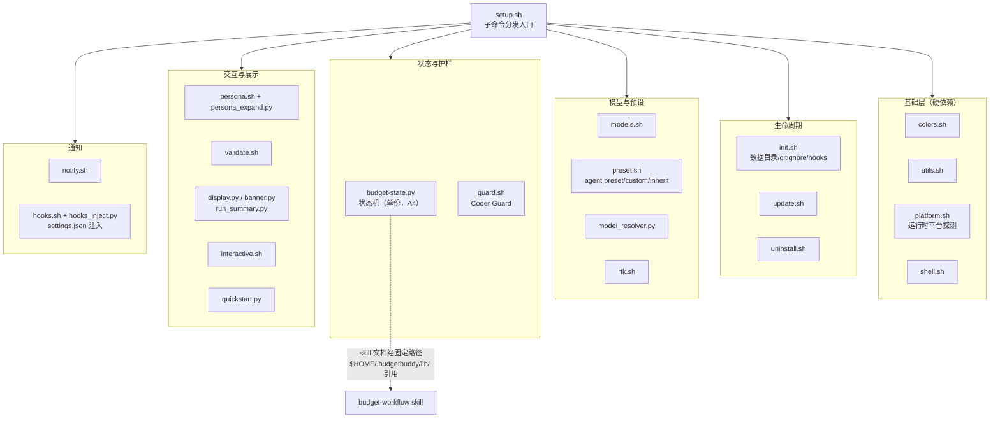
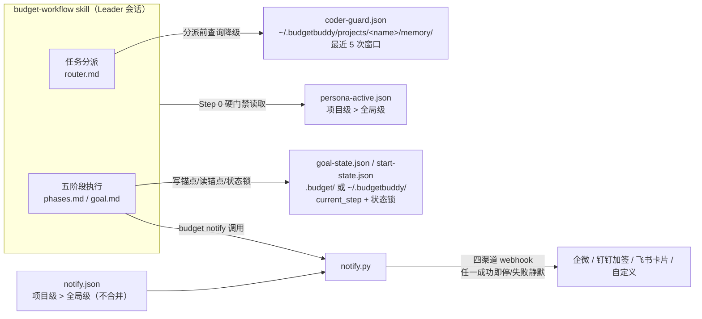

# BudgetBuddy 架构说明

> 本文档描述 BudgetBuddy 的组件关系与数据流。工作流级（五阶段、角色协作）流程图见 README 的「架构」章节；本文聚焦构建链路与运行时组件。

## 总览

BudgetBuddy 的核心设计是**单一中立源 + 构建期平台适配**：所有内容只在 `core/` 维护一份，`scripts/build.py` 按 `core/platform/*.yaml` 声明的映射 DSL 生成四平台产物，安装器把产物落到各平台的约定位置。

```mermaid
flowchart LR
    subgraph SRC["core/（单一中立源）"]
        AGENTS["agents/*.md<br/>10 个 agent"]
        CMDS["commands/{budget,opsx}/*.md<br/>7 个命令"]
        SKILLS["skills/*/<br/>6 个 skill"]
        RULES["rules/*.md<br/>12 条规则"]
        HOOKS["hooks/*.py"]
        LIB["lib/<br/>24 个管理面模块"]
        MODELS["models/budget-models.json"]
        PERSONAS["personas/personas.json"]
        DOCS["docs/*<br/>含模板与说明<br/>codex-runtime.md 派工契约"]
        DSL["platform/*.yaml<br/>映射 DSL"]
    end

    subgraph BUILD["scripts/"]
        BP["build.py<br/>YAML 解析 + schema 校验<br/>frontmatter 重写 + 变量替换<br/>routing 落位 + manifest"]
        SCAN["scan-brand.py<br/>品牌门禁"]
        REL["build-release.sh<br/>zip + sha256"]
    end

    subgraph DIST["dist/（构建产物，禁手改）"]
        DC["codebuddy/"]
        DCC["claudecode/"]
        DO["opencode/"]
        DCX["codex/"]
    end

    INST["install.sh<br/>下载 + SHA256 校验<br/>增量同步 + 本地清单"]

    subgraph RT["运行时（用户侧）"]
        CB["CodeBuddy<br/>.codebuddy/ 或 ~/.codebuddy/"]
        CC["Claude Code<br/>.claude/ 或 ~/.claude/"]
        OC["OpenCode<br/>.opencode/ 或 ~/.config/opencode/"]
        CX["Codex<br/>.codex/ 或 ~/.codex/<br/>skill 目录形态"]
        MGMT["~/.budgetbuddy/<br/>管理面 + 数据"]
    end

    SRC --> BP
    BP -->|"原子替换"| DIST
    BP --> SCAN
    DIST --> REL
    REL -->|"release zip"| INST
    SRC -->|"本地仓库直装"| INST
    INST -->|"结构性文件"| CB
    INST -->|"结构性文件"| CC
    INST -->|"结构性文件"| OC
    INST -->|"管理面 + 数据目录"| MGMT
    CB -.->|"读取"| MGMT
    CC -.->|"读取"| MGMT
    OC -.->|"读取"| MGMT
    CX -.->|"读取"| MGMT
```

## 构建链路

1. **解析**：`build.py` 用内置的最小 YAML 子集解析器读取 `core/platform/*.yaml`（无第三方依赖），并做 DSL schema 校验（缺 routing 键等即构建失败）
2. **转换**：按 DSL 逐文件转换——agent frontmatter 按平台 emit/drop 规则重写（权限三态映射为 CodeBuddy/Claude Code `permissionMode` 或 OpenCode `permission` map；Codex 素材仅 emit name/description 元数据、drop 模型/权限键，模型不烘焙——spawn 时查表）；正文模板变量（`{{TASK_TOOL}}` 等六变量）按平台白名单精确替换（Codex 端 `{{TASK_TOOL}}` → `spawn_agent`）
3. **渲染**：`docs/MODEL_SELECTION.template.md` + `budget-models.json` 按平台渲染出 `docs/MODEL_SELECTION.md`（占位符与六变量共用替换器但白名单独立）
4. **落位**：routing 规则决定每个源文件的目标路径（CodeBuddy/Claude Code 命令 `/budget:start`、OpenCode 命令 `/budget-start`；OpenCode 与 Claude Code 侧 12 条规则分别合并为单文件 `AGENTS.fragment.md`/`CLAUDE.fragment.md` 标记区块；Codex 为 skill 目录形态——agents/commands 平移为 skill 内素材、规则经 `rules_index` kind 生成轻量索引 fragment `AGENTS.fragment.md`（<1KiB，规避 AGENTS.md 32KiB 截断），全文经 skill 内 `rules/` 按需读取）
5. **清单**：写 `dist/<platform>/.manifest.json`（路径 → SHA256，按键排序、无时间戳），作为安装器增量同步与升级差集清理的依据
6. **原子性**：先构建到 `dist/<platform>.new/` 临时目录，全部成功后原子替换；失败保持原样

### Codex 平台层

- **产物形态**：`dist/codex/` 为 skill 目录形态——套件以 `skills/budget-workflow/`（SKILL.md + 参考文档 + agents/commands 素材 + `rules/` 全文 + `codex-runtime.md` 派工契约）落位；Codex 原生加载 `~/.codex/skills/` 与项目级 `.codex/skills/` 的 SKILL.md
- **AGENTS 轻量索引**：`rules_index` kind 从 core/rules/ 文件名单次遍历生成轻量索引 fragment（外层 markers + 按需读取指引 + 规则清单，<1KiB），安装器幂等合并进项目根 `AGENTS.md`（全局形态 `~/.codex/AGENTS.md`）——规避 Codex AGENTS.md 默认 32KiB 截断上限；规则全文走 skill 内按需读取
- **config.toml 注入**：安装器向 `~/.codex/config.toml`（或项目 `.codex/config.toml`）幂等注入 `[features] multi_agent = true`（注入前备份 + 原子写），启用 `spawn_agent`/`wait_agent`/`close_agent` 多代理工具；注入仅触碰本键，用户其他配置零触碰
- **派工契约**：`core/docs/codex-runtime.md` 经 docs 分发进 skill——spawn 调用模板、prompt 组装规则、三档模型查表（`platforms.codex` 部署别名）、并行规则；`{{TASK_TOOL}}` 在 Codex 端替换为 `spawn_agent`，无结构化 Task 工具强约束
- **hooks 不分发**：Codex hooks 实验态，维持降级；`budget notify` CLI 仍可用

## lib 模块分组

- **基础层**：`platform.sh` 运行时探测（codebuddy 项目级 → codebuddy 全局 → claudecode 项目级 → claudecode 全局 → codex 项目级 → codex 全局 → opencode 项目级优先/全局），均未命中显式报错
- **状态机单份化**：`budget-state.py` 仅 lib 一份，skill 文档以 `$HOME/.budgetbuddy/lib/budget-state.py` 固定路径引用（四平台落位后均成立）
- **hooks 注入**：CodeBuddy 与 Claude Code；注入前备份 `settings.json.bak-budget`，临时文件 + 原子 rename 写入，同时负责 superpowers 插件启用检测（CodeBuddy）；OpenCode 无 hooks 等价物、Codex hooks 实验态不分发
- **Codex preset 降级**：codex 形态无 agent frontmatter 模型可改写——`agent preset/custom/inherit` 降级为档位查询指引，`show` 输出三档映射表

## 运行时数据流

- **状态机防脱轨**：Leader 每次等待用户回复前写 `current_step` 锚点、收到回复后读锚点，禁止仅凭 context 记忆推断流程位置；Director 调用前强制检查状态锁防重复调用
- **Coder Guard 固定全局路径**：跨会话汇总降级判定（最近 5 次失败 ≥2 → lite→standard→senior 逐级改派）；项目级 memory/ 仅存项目态数据
- **配置双级降级**：persona 与 notify 配置均为「项目级存在即生效、否则降级全局级，不合并」
